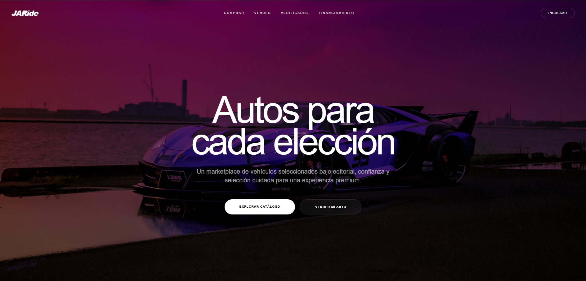
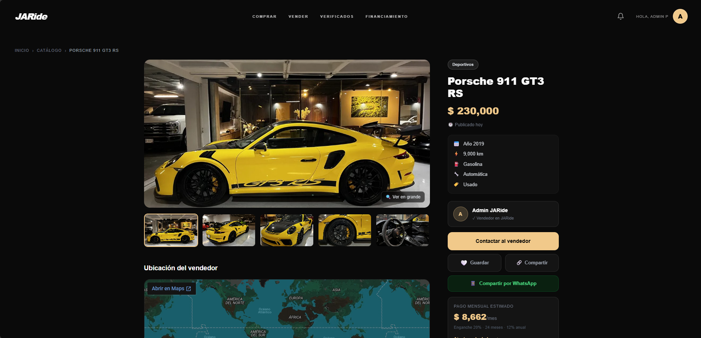
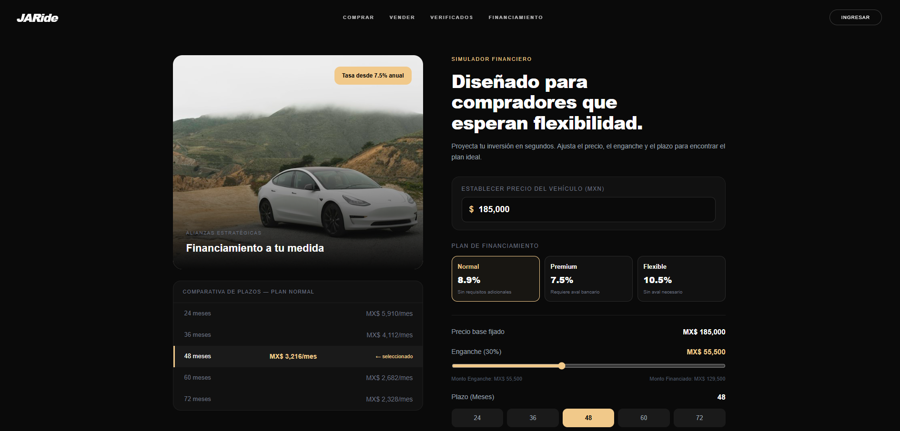
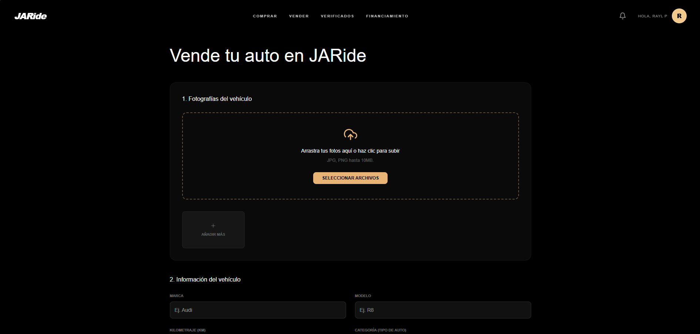
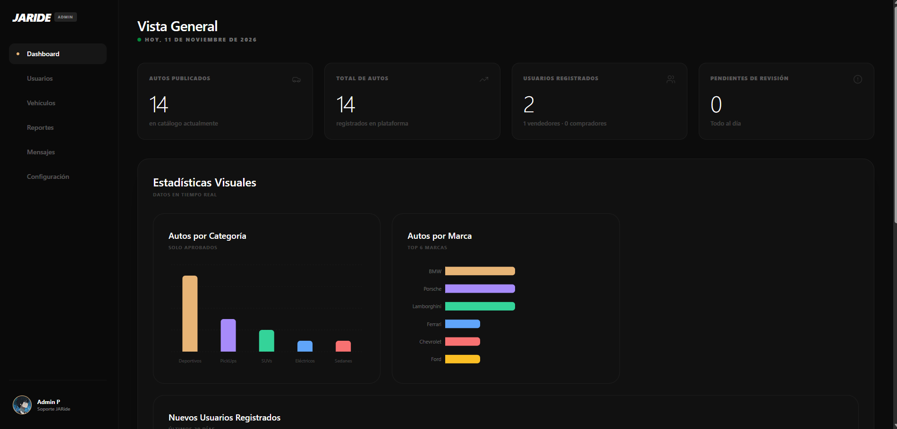
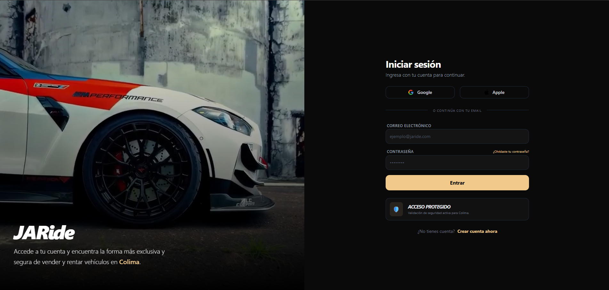
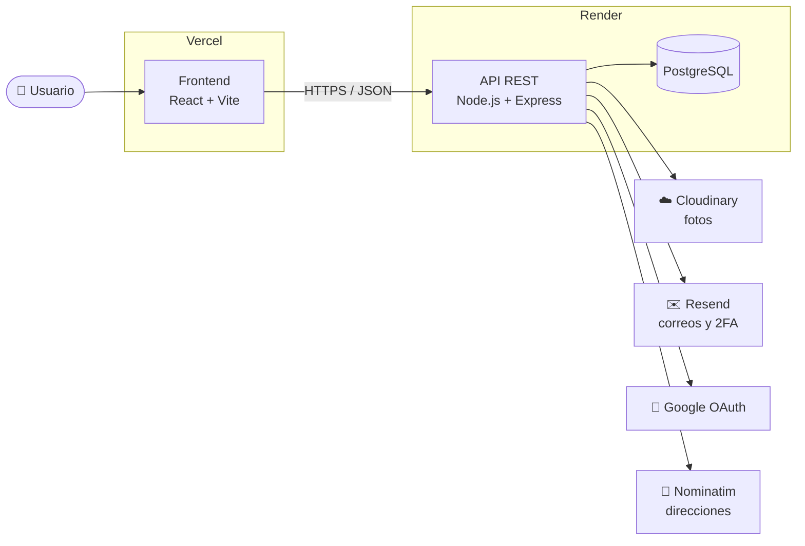

<div align="center">

# JARide

### Marketplace de vehículos seminuevos, curado y seguro

Compra y vende autos verificados desde el navegador: explora el catálogo, calcula tu financiamiento al instante y habla directo con el vendedor.

<br>

[](https://ja-ride.vercel.app)

<br>


<br>



</div>

<br>

## 📑 Contenido

| | | |
|---|---|---|
| [💡 La idea](#-la-idea) | [✨ Funcionalidades](#-funcionalidades) | [📸 Recorrido](#-recorrido-por-la-plataforma) |
| [🧭 Arquitectura](#-arquitectura) | [🛡️ Seguridad](#️-seguridad) | [🧰 Tecnologías](#-tecnologías) |
| [📁 Estructura](#-estructura-del-proyecto) | [🚀 Cómo ejecutarlo](#-cómo-ejecutarlo) | [👥 Equipo](#-equipo) |

<br>

## 💡 La idea

Comprar un auto usado en línea suele significar anuncios sin revisar, información incompleta y poca confianza en el vendedor. **JARide** propone un marketplace con selección editorial: cada publicación pasa por revisión antes de aparecer en el catálogo.

| Problema | Cómo lo resuelve JARide |
|---|---|
| 🚩 Anuncios falsos o poco confiables | Cada auto pasa por **revisión del administrador** y existe un catálogo de **autos verificados** |
| 💸 No sabes si te alcanza | **Simulador de financiamiento** con planes, enganche y plazo ajustables |
| 📞 Contactar al vendedor es complicado | **Mensajería interna** y contacto directo por WhatsApp |
| 📍 No sabes dónde está el auto | **Mapa con la ubicación** del vendedor en cada publicación |

> Proyecto presentado en **Innovatec 2026** · Tecnológico Nacional de México, Campus Colima.

<br>

## ✨ Funcionalidades

<table>
<tr>
<td width="50%" valign="top">

### 🛒 Compradores
- Catálogo con búsqueda y filtros por categoría
- Ficha de cada auto con galería de fotos
- Ubicación del vendedor en el mapa
- Pago mensual estimado en cada publicación
- Simulador de financiamiento
- Favoritos y botón para compartir
- Mensajes con el vendedor y contacto por WhatsApp
- Reporte de publicaciones sospechosas

</td>
<td width="50%" valign="top">

### 🏷️ Vendedores
- Publicación guiada en dos pasos: fotos y datos
- Carga de fotos a la nube (Cloudinary)
- Autocompletado de direcciones en México (OpenStreetMap)
- Perfil con sus autos publicados
- Edición de datos, contraseña y eliminación de cuenta

</td>
</tr>
<tr>
<td width="50%" valign="top">

### 🛠️ Administración
- Panel con métricas: autos publicados, usuarios y pendientes
- Gráficas por categoría, marca y usuarios por mes
- Moderación: aprobar o rechazar publicaciones
- Gestión de usuarios, vehículos, reportes y mensajes
- Exportación de autos y usuarios

</td>
<td width="50%" valign="top">

### 🔐 Cuentas
- Registro e inicio de sesión con correo o **Google**
- **Verificación en dos pasos** con código por correo
- Recuperación de contraseña por correo
- Roles: comprador, vendedor y administrador

</td>
</tr>
</table>

<br>

## 📸 Recorrido por la plataforma

### Inicio

Una portada editorial con colecciones destacadas y testimonios de clientes.


### Ficha del vehículo

Galería de fotos, ficha técnica, datos del vendedor, ubicación en el mapa y pago mensual estimado.



### Simulador de financiamiento

Elige el plan (Normal, Premium o Flexible), ajusta el enganche y compara el pago mensual en distintos plazos.



### Publicar un auto



### Panel de administración



### Inicio de sesión



<br>

## 🧭 Arquitectura



Frontend y backend viven en este mismo repositorio (**monorepo**) y se despliegan por separado: **Vercel** publica `frontend/` y **Render** publica `backend/`.

<br>

## 🛡️ Seguridad

| Medida | Implementación |
|---|---|
| 🔑 Contraseñas | Cifradas con **bcrypt** |
| 🎫 Sesiones | **JWT** en cookie `httpOnly`, inaccesible desde JavaScript |
| 🧱 CSRF | Token por sesión |
| 🔒 Datos sensibles | Teléfono y dirección cifrados con **AES-256-GCM** |
| 📧 Doble factor | Código de verificación por correo |
| 💉 Inyección SQL | Consultas parametrizadas en PostgreSQL |
| 🗝️ Secretos | Fuera del código, en variables de entorno |

<br>

## 🧰 Tecnologías

| Capa | Herramientas |
|---|---|
| **Frontend** | React 19 · Vite · React Router 7 · Tailwind CSS 4 · Framer Motion · Recharts |
| **Backend** | Node.js · Express 5 · Multer |
| **Base de datos** | PostgreSQL |
| **Autenticación** | JWT · bcrypt · Google OAuth · 2FA por correo |
| **Servicios** | Cloudinary · Resend · Nominatim (OpenStreetMap) |
| **Pruebas** | Vitest · Testing Library |
| **Despliegue** | Vercel · Render |

<br>

## 📁 Estructura del proyecto

```
JARide/
├── frontend/                  # Aplicación React
│   ├── public/autos/          # Fotos del catálogo inicial
│   └── src/
│       ├── components/        # Navbar, VenderForm, Searchbar, admin/…
│       ├── pages/             # Inicio, Comprar, Detalles, Finanzas, Perfil…
│       │   ├── admin/         # Panel de administración
│       │   └── test/          # Pruebas con Vitest
│       └── App.jsx            # Rutas
│
├── backend/                   # API REST
│   ├── server.js              # Rutas, autenticación y conexión a PostgreSQL
│   ├── scripts/               # Utilidades (asignar admin, cargar catálogo)
│   └── .env.example           # Variables de entorno necesarias
│
└── docs/capturas/             # Imágenes de este README
```

<br>

## 🚀 Cómo ejecutarlo

**Requisitos:** [Node.js](https://nodejs.org/) 18+, una base de datos **PostgreSQL** y cuentas en **Cloudinary** y **Resend**.

```bash
# 1. Clonar
git clone https://github.com/raulchvzt/JARide.git
cd JARide

# 2. Backend
cd backend
npm install
cp .env.example .env        # llena los valores
node server.js              # 🚀 Servidor listo en puerto 5000

# 3. Frontend (en otra terminal)
cd frontend
npm install
cp .env.example .env        # VITE_API_URL=http://localhost:5000
npm run dev                 # http://localhost:5173
```

> Al arrancar, el backend **crea las tablas automáticamente** si no existen.

<details>
<summary><b>Variables de entorno del backend</b></summary>

<br>

| Variable | Descripción |
|---|---|
| `PORT` | Puerto del servidor (por defecto `5000`) |
| `API_URL` | URL pública del backend |
| `DATABASE_URL` | Cadena de conexión de PostgreSQL |
| `JWT_SECRET` | Clave para firmar los tokens de sesión |
| `ENCRYPTION_KEY` | Clave de 32 caracteres para el cifrado AES-256-GCM |
| `RESEND_API_KEY` | Clave de Resend para enviar correos |
| `EMAIL_USER` / `EMAIL_PASS` | Cuenta de correo del sistema |
| `CLOUDINARY_CLOUD_NAME` | Nombre de tu cuenta de Cloudinary |
| `CLOUDINARY_API_KEY` / `CLOUDINARY_API_SECRET` | Credenciales de Cloudinary |

</details>

<details>
<summary><b>Pruebas</b></summary>

<br>

El frontend incluye pruebas con **Vitest** y **Testing Library** para el inicio de sesión, la publicación de autos y la ventana de compra.

```bash
cd frontend
npm test
```

</details>

<details>
<summary><b>Despliegue</b></summary>

<br>

| Parte | Plataforma | Carpeta |
|---|---|---|
| Frontend | Vercel | `frontend/` |
| Backend | Render (Web Service) | `backend/` |
| Base de datos | Render (PostgreSQL) | — |

El backend usa el plan gratuito de Render, así que puede tardar unos segundos en responder la primera vez si estuvo inactivo.

</details>

<br>

## 👥 Equipo

| Integrante | Rol |
|---|---|
| **Raúl Alejandro Chávez Torres** · [@raulchvzt](https://github.com/raulchvzt) | Desarrollo full stack: frontend, API REST, base de datos, autenticación y despliegue |
| **Belinda Cárdenas** · [@usuario](https://github.com/belipop-123) | Desarrollo frontend |

<br>

---

<div align="center">

Hecho con ☕ en Colima, México · Proyecto académico sin fines comerciales

</div>
